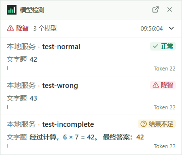
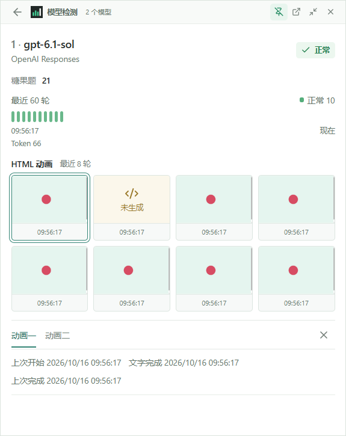
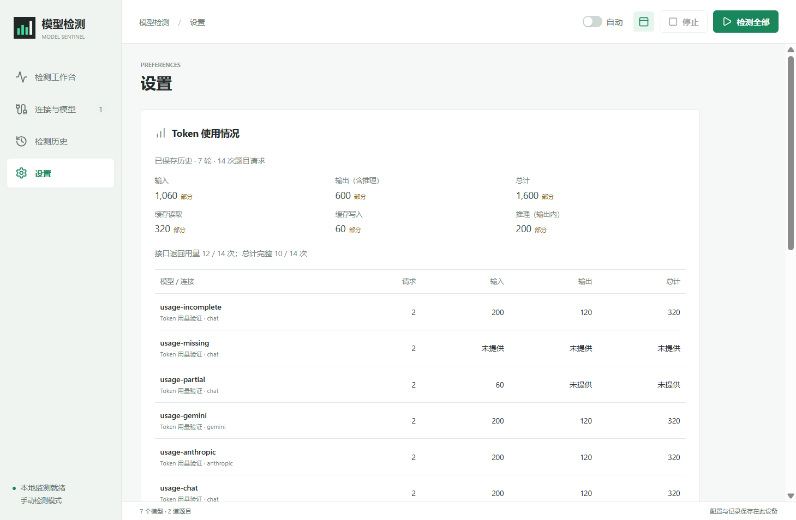

# Model Sentinel

[](https://github.com/eifelsir/model-sentinel/actions/workflows/ci.yml)
[](https://github.com/eifelsir/model-sentinel/releases/latest)
[](LICENSE)

A Windows desktop monitor for model answer consistency, HTML/SVG generation, and Token usage. Connect your own endpoints and keys, run repeatable questions across models, and keep the results visible in a compact desktop widget.

**[中文说明](README.zh-CN.md) · [Download for Windows x64](https://github.com/eifelsir/model-sentinel/releases/latest) · [Report a bug](https://github.com/eifelsir/model-sentinel/issues/new/choose)**

The interface is currently in Simplified Chinese. No hosted account or additional judging model is required.

## Features

- **Multiple endpoints and models.** Responses API, Chat Completions, Gemini native, and Claude Messages; model discovery and manual IDs. OpenAI, Grok, Gemini, Claude, and compatible intermediary services.
- **Repeatable questions.** Several questions per model, local answer extraction and comparison, concurrent requests, configurable intervals, and manual or automatic runs.
- **Optional model assistance.** When local automatic extraction is unclear, use the current model or another configured model once to extract an answer with a quotation. Expected answers stay local; auxiliary usage and evidence are recorded.
- **Desktop monitor.** A narrow, traffic-monitor-style always-on-top window keeps connection/model names, verdicts, text answers, history bars and Token totals visible. Hover to inspect the list, click a model to pin its details, or use Escape to collapse. It snaps to screen edges and remembers position and detail size.
- **HTML/SVG tests.** Generate a complete SVG animation page. Browse the selected model's most recent eight rounds as real thumbnails and open an interactive, isolated preview in a separate window.
- **Token accounting.** Per-question and per-round input/output totals, available cache/reasoning details, and per-model totals across retained history. Missing or partial reporting is explicitly labeled.
- **Model settings.** Provider-aware reasoning choices, output limits, timeouts, per-model question selection, and advanced request JSON.
- **Optional cache bypass.** Saved switches in the workbench and Settings request fresh input with a per-request random prefix and cache directives across all four protocols, including HTML and auxiliary extraction.
- **Local persistence.** Atomic configuration saves, encrypted keys, a backup copy, and key-free JSON export.
- **Built-in questions.** Milk and candy reasoning questions, plus an editable HTML/SVG bicycle animation prompt.

## Screenshots







Screenshots use local test responses. They illustrate the application, not a benchmark of the named providers.

## Quick Start

1. Download `Model-Sentinel-1.3.0-Windows-x64.exe` from [Releases](https://github.com/eifelsir/model-sentinel/releases/latest) and open it. Node.js is not needed.
2. Select a built-in question or create one with a prompt and expected answer. Choose the HTML/SVG type for page-generation questions.
3. Add a connection with its **Base URL**, **KEY**, and **protocol**. Fetch the model list or enter a model ID.
4. Assign questions to each model and start detection. Enable automatic detection for recurring checks.

Close the main window to keep monitoring from the system tray. Use **退出** in the tray menu to quit. Drag the compact widget's title bar to move it; it snaps near screen edges. Hover over the body to expand the model list and move away to collapse. Click a model to keep its details open, or click the summary to pin the list. The header provides back, pin, collapse and main-window controls; Escape also collapses. Resize the expanded window as needed. HTML thumbnails open separately.

When upgrading, exit the previous version from its tray before opening the new executable. Existing configuration is reused. The version and actual data folder are shown in Settings.

## Protocols

| Service | Common Base URL | Protocol |
| --- | --- | --- |
| OpenAI | `https://api.openai.com/v1` | Responses / Chat Completions |
| Grok | `https://api.x.ai/v1` | Chat Completions / Responses |
| Gemini | `https://generativelanguage.googleapis.com/v1beta` | Gemini native |
| Claude | `https://api.anthropic.com/v1` | Claude Messages |
| Compatible services | Your provider's endpoint | Select the protocol it supports |

Model discovery and available models depend on your provider and account. Custom URL prefixes are preserved. Reasoning controls are offered for verified model/protocol combinations; unknown IDs use the service default and can use advanced JSON. See [reasoning support](docs/reasoning-support.md).

## What Results Mean

| Result | Meaning |
| --- | --- |
| 正常 / Normal | Every selected text answer matched. HTML generation does not affect this verdict. |
| 降智 / Mismatch | At least one explicit extracted answer differed from the configured answer. |
| 结果不足 / Insufficient | No explicit text mismatch, but a text request failed, timed out, was refused/truncated, or lacked an unambiguous result. |
| 已生成 / Generated | An HTML-only round returned complete HTML containing SVG. This does not grade visual quality. |

Text results and history bars update as soon as text evaluation finishes, while HTML may still be generating. With several text questions, a mismatch appears immediately and a normal verdict requires all text questions to finish. Queued text requests run before queued HTML requests. HTML pages remain available for human inspection; their success or failure does not change a text verdict.

Expected answers stay local. Original test prompts are sent unchanged with cache bypass off (the default). The automatic extractor ignores structured reasoning, supports quantity conclusions and boxed answers, and keeps conflicting or uncertain conclusions insufficient. Exact and regex modes are also available.

**答案辅助判定模型** in Settings is off by default. Select the current tested model or another configured model to make at most one extra extraction call when local automatic extraction is unclear. This includes differing values tied to conditional background or hypothetical interpretations, such as the milk reply's background height and the candy reply's alternative random-draw answer. These values remain insufficient without assistance; the app does not silently discard a number or choose one because it matches the expected answer. Conflicting unconditional conclusions still do not trigger assistance.

The assistant receives the original question and reply with known saved keys redacted, but no expected answer; it must return a complete literal answer and a quotation found in the reply. Quotation matching tolerates Markdown, LaTeX presentation, whitespace and escaped punctuation differences while preserving numeric values, signs and arithmetic boundaries. Comparison remains local. Evidence, model identity and auxiliary Token usage are shown in details; rejected quotations have a specific explanation. Explicit uncertainty, unfinished expressions, failed requests, refusals, truncation and HTML do not trigger assistance. Cancelled auxiliary calls remain usage samples with unknown counters. Model assistance can itself be wrong; inspect the quoted evidence for disputed results.

A mismatch describes these configured tests. It cannot establish a model's overall intelligence, identity, or whether a provider changed it. API calls, including enabled auxiliary extraction calls, may incur provider charges. No automatic retries are made.

### Caching

Each test sends a new request; the app does not cache answers or append earlier test replies as chat history. Provider prompt/prefix caching reuses input computation while generating a new answer. For example, [OpenAI prompt caching](https://developers.openai.com/api/docs/guides/prompt-caching) does not change the output; a hit alone does not invalidate an answer check. Cache hits can affect latency and cost, so they do not measure cold-input latency.

A proxy's full-response cache is different: it can return an earlier answer instead of calling the model, as documented by [LiteLLM response caching](https://docs.litellm.ai/docs/proxy/caching). Disable that cache for ongoing monitoring of current service behavior. A backend's generic "cache hit" label does not establish which type it uses, and input cache-read Token counts alone do not prove an entire answer was replayed.

**绕过缓存 / Bypass cache** is off by default. Enable it in the workbench or Settings to prepend a new random request identifier, keep the original question after it, send `Cache-Control: no-cache, no-store` and `Pragma: no-cache`, and omit explicit cache-reuse fields from advanced JSON. It applies from the next round to text, HTML and auxiliary extraction requests. Round details retain that bypass was requested; turning it off restores the original prompt and configured cache options. Model discovery is unchanged.

For recognized OpenAI GPT-5.6 and GPT-6 Sol/Astra/Luna families, Responses and Chat Completions additionally request `prompt_cache_options: {"mode":"explicit"}` without cache breakpoints. The [official OpenAI guide](https://developers.openai.com/api/docs/guides/prompt-caching#opt-out-of-caching) documents this as skipping prompt-cache reads and writes. Older or unrecognized models retain the generic bypass; Anthropic requests omit explicit cache breakpoints. No automatic retry drops native cache controls if a proxy rejects them.

Round details show the actual requested strategy and returned cache-read Tokens, including nonzero counts after bypass and missing counters. This cannot guarantee that a proxy honors native options/directives or bypass a semantic cache that ignores the identifier. Zero input-cache Tokens do not establish that an entire response was generated anew. The prefix changes the model-visible input and adds a small Token overhead, so it may affect replies and cost. For guaranteed service-side behavior, use the provider's own full-response-cache settings. See [cache bypass and verification limits](docs/cache-bypass.md).

## Data and Privacy

- Normal data directory: `%APPDATA%/Model Sentinel`.
- Keys are encrypted with Electron `safeStorage` using the Windows account. An encrypted backup is written with the main state.
- Configuration and history remain local. The application sends prompts and authentication only to the configured endpoints.
- Exports omit stored keys. Response text, questions, and generated pages remain in history, so inspect exports before sharing them.
- HTML previews use an isolated sandbox with application/Node access, network fetches, popups, forms, and external navigation restricted. External page assets are not loaded.
- Retain up to 1,000 completed rounds, plus active rounds. Token summaries cover these retained records, not lifetime billing. Old records without usage remain unknown. See [Token accounting](docs/token-usage.md).

Keep the application running for scheduled checks. Detection pauses while the computer is asleep or the app is closed. A Windows account change or a move to another computer can require re-entering keys.

## Development

Requirements: Windows x64 and Node.js 24 LTS. The source uses Electron, React, Vite, Lucide, and parse5.

```powershell
npm ci
npm test
npm run start
```

Build before running desktop scenarios. Run graphical checks sequentially:

```powershell
npm run build
npm run test:desktop
npm run test:usage
npm run test:judgement
npm run test:html
npm run test:answers
npm run test:floating
npm run test:cache
node scripts/desktop-boundary-qa.mjs
node scripts/desktop-regressions.mjs
```

Tests use isolated temporary profiles and local HTTP fixtures. They do not need paid API credentials or modify your normal saved configuration.

Create a portable Windows executable:

```powershell
npm run package
node scripts/packaged-smoke.mjs
node scripts/portable-smoke.mjs
```

If a runtime download is unavailable, package using the matching Electron already installed by `npm ci`:

```powershell
npm exec electron-builder -- --win portable --x64 --config.electronDist=node_modules/electron/dist
```

Release files go to `release/`; local reports and screenshots go to `artifacts/`. CI runs the core and desktop scenarios on Windows. Portable executables are currently unsigned.

## Contributing

Bug reports and focused improvements are welcome. Read [CONTRIBUTING.md](CONTRIBUTING.md) for the development workflow and [SECURITY.md](SECURITY.md) for security reports. See [CHANGELOG.md](CHANGELOG.md) for release notes.

## License

[MIT](LICENSE) © 2026 Eifel.
